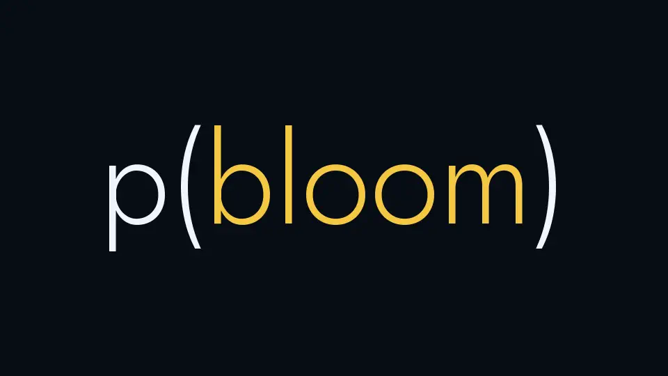
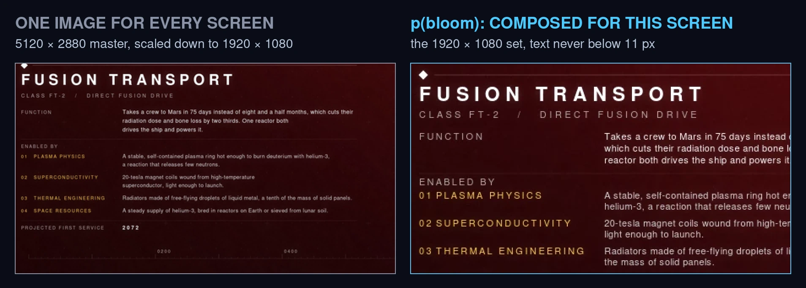
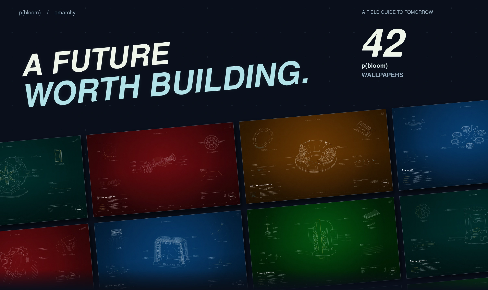
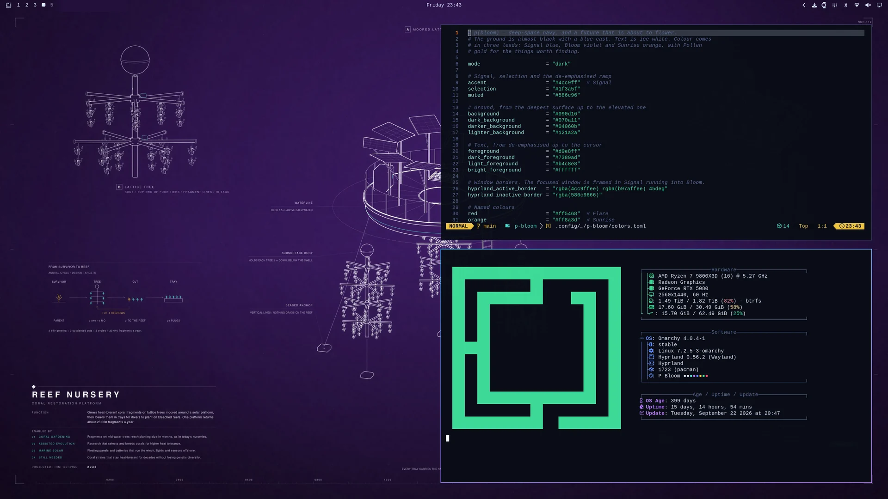

**[▶ Watch the music video (sound on) and read how it was made](https://jacekbecela.com/blog/omarchy-p-bloom-theme/)**

[](https://jacekbecela.com/blog/omarchy-p-bloom-theme/)

**p(bloom) is a theme for [Omarchy](https://omarchy.org).** Deep-space navy, ice-white text, Signal · Bloom · Sunrise. And 42 blueprint wallpapers of machines from a future worth building: the theme comes with ten, one for each background colour, and the companion app brings the rest.

```bash
omarchy theme install https://github.com/ncr/omarchy-p-bloom-theme.git
```

### Composed for your screen, not scaled to it



Each wallpaper is laid out again for 18 screens, from 1080p to 7680 × 2160, in 16:9, 16:10, 3:2, 4:3, 21:9 and 32:9. Backgrounds come in three strengths, Muted, Default and Vivid, with every caption kept readable in each.

### p(bloom) Wallpapers

The companion app is a gallery for the 42 wallpapers: ← → browse, ↑ ↓ show one at another intensity, Enter puts it on your desktop. It also downloads the set made for your monitors and switches when you plug in another screen, and offers its own updates when there are new wallpapers. Open it from Omarchy's menu (Super + Space, type `pbloom`).

It lives in its own repository, [ncr/p-bloom-wallpapers](https://github.com/ncr/p-bloom-wallpapers), with what it installs and how it works:

```bash
git clone https://github.com/ncr/p-bloom-wallpapers.git ~/.local/share/p-bloom-wallpapers/checkout
python3 ~/.local/share/p-bloom-wallpapers/checkout/companion/install.py
```

Removing the theme (Remove > Theme) removes the app with it.





<sub>[All 42 wallpapers](previews/wallpapers.webp) · [MIT](LICENSE) · Omarchy wordmark from [Omarchy](https://github.com/basecamp/omarchy).</sub>
